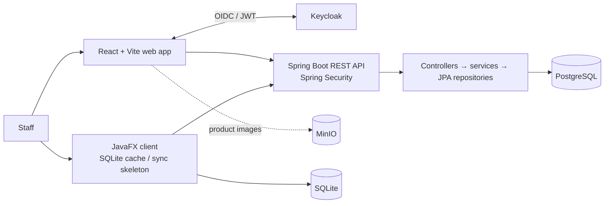
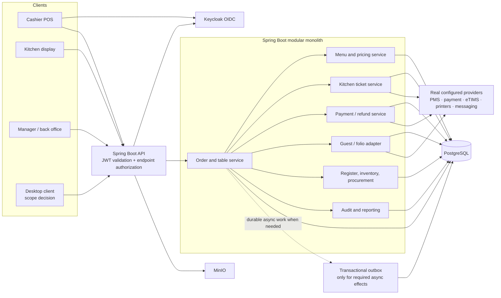

# Target architecture (design proposal)

**Status:** proposed for review. This preserves the current modular-monolith stack and does not claim the proposed external integrations exist.

## Current structure

The production web/API topology uses Docker/Compose and Nginx configuration. Desktop offline behavior is not considered safe for transactional payment use until sync contracts, conflict resolution, identity, and idempotency are specified and tested.

## Proposed logical components

### Architectural rules

- Keep this a modular monolith unless measurable needs justify otherwise. Modules communicate through application/service contracts, not direct controller-to-controller calls.
- Server-side services own state transitions, authorization decisions, totals, stock effects, and idempotency. UI permissions improve usability but do not replace API checks.
- Use request/response DTOs at external API boundaries. Avoid exposing mutable JPA object graphs as long-lived API contracts.
- Keep `Order`, `KitchenTicket`, `Payment`, `Table`, and `RegisterSession` as related but distinct lifecycles. A table becoming occupied does not mean a payment succeeded; a kitchen ticket becoming ready does not complete the order.
- Persist price/tax/discount/modifier snapshots with accepted order lines so catalog changes do not rewrite history.
- Use short-lived authorized object URLs or backend-proxied access for MinIO; never make arbitrary object storage public.
- External calls cannot share a PostgreSQL transaction. Persist intent/idempotency first, handle provider callbacks/retries, and reconcile ambiguous outcomes. Add an outbox only where the required async delivery needs it.
- Branch/tenant boundaries are an open requirement. Do not add branch identifiers to every table until the operator confirms whether the deployment represents one venue or multiple branches/properties.

## Main target interaction

1. Staff signs in through Keycloak; the API validates issuer, signature, audience policy, expiry, and mapped roles.
2. Cashier loads available catalog, prices, tax configuration, tables, and permitted guest information from APIs.
3. The API creates/updates one authoritative order and snapshots line options and notes.
4. Submission creates kitchen work in the same local database transaction (or a durable outbox event if a distinct asynchronous boundary is needed).
5. The KDS updates kitchen ticket/item states; the order service validates allowed transitions.
6. Checkout records one or more payment attempts/allocations. Only verified provider success or accepted cash tender changes paid state.
7. Receipt/history, stock/cash effects, and audit events reference the same order/payment identities.
8. Room-charge posting additionally verifies the guest stay/room with the PMS and records provider folio status and reconciliation reference.

## Decision points before implementation

- Is the JavaFX desktop/offline client in release scope? If yes, which actions are allowed offline? Electronic payment and room folio posting should not be queued as generic CRUD writes.
- Which PMS API is authoritative for stay, guest, room, posting, void, and checkout reconciliation?
- Which M-Pesa/card provider(s) and callback model are actually configured?
- Are customer ordering, bar-specific routing, eTIMS, printers, SMS/email, multiple branches, and loyalty in the first release?
- Is kitchen routing by category/product or by configured preparation station?

## Current → proposed migration principle

Do not delete/replace existing `Sales` or `RestaurantOrder` data in the design stage. First map keys, table links, status history, and receipts; then choose a compatible migration that introduces a single order identity and preserves historical reads. Use expand-and-contract if production data needs a staged transition.
