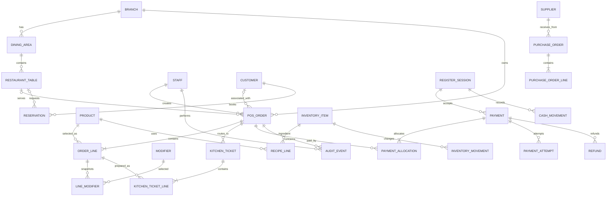
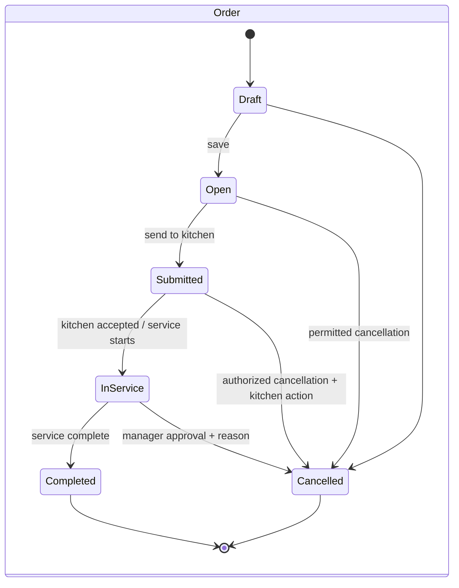
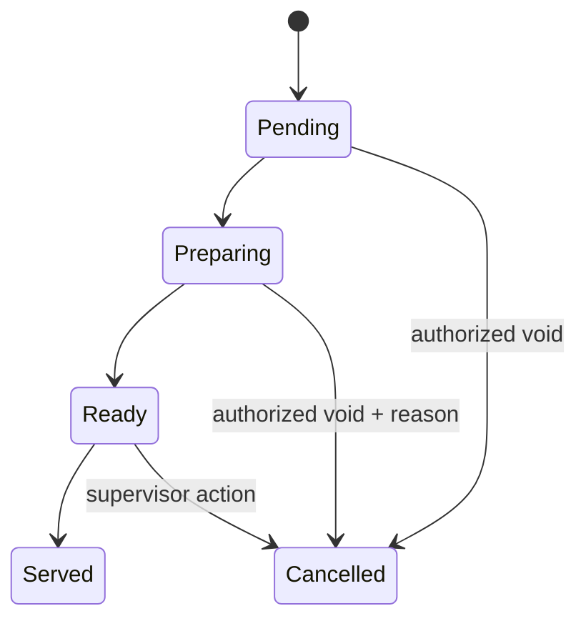
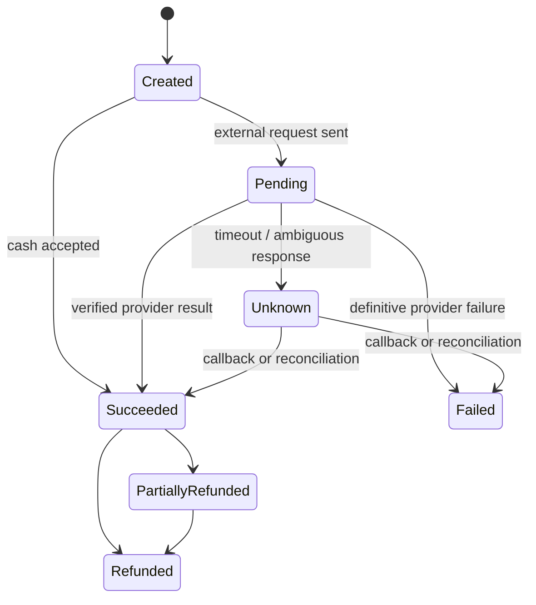
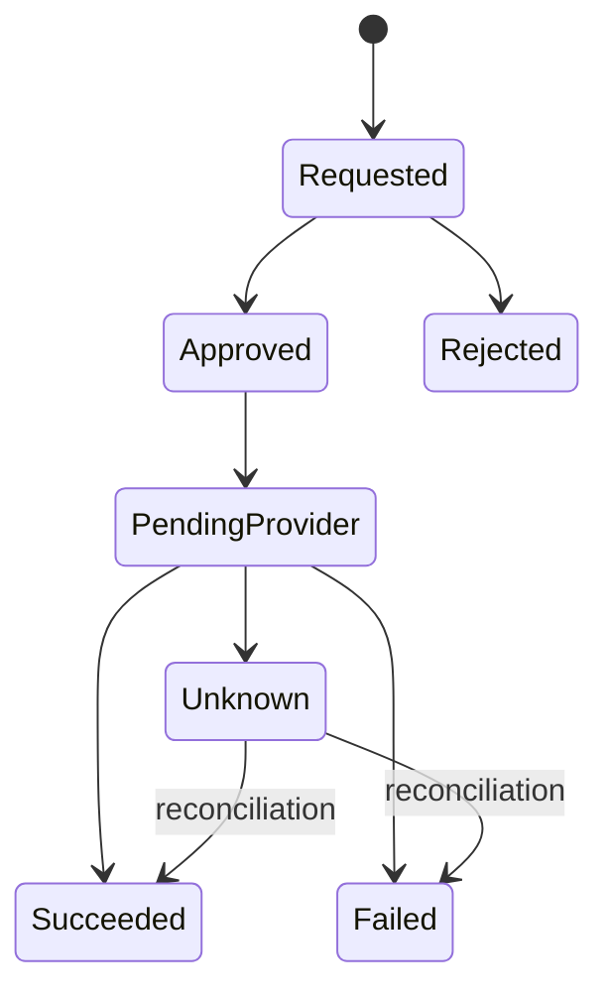
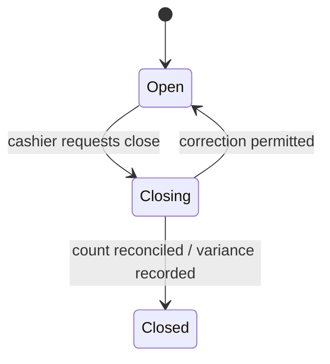

# Domain model and state design

**Status:** conceptual target model for review; not a migration specification. Existing entities are summarized in `CURRENT_STATE_AUDIT.md`.

## Proposed conceptual ER model

`BRANCH`, `RECIPE_LINE`, register cash movements, payment attempts/allocations/refunds, and PMS folio references are proposed only if confirmed by requirements. An external PMS should remain authoritative for stay and folio balances; store provider identifiers and posting/reconciliation status, not a copied fake stay ledger.

## State machines

Reservation states should be mapped from the existing enum and business process before standardizing. Table availability/occupancy/cleaning is a separate state machine; it should be derived or transitioned under a concurrency-safe table service, not copied from order/payment status.

## Invariants and transaction boundaries

- A submitted order has at least one valid active product line, bounded quantities, catalog-valid modifier selections, and a server-computed price snapshot.
- Dine-in requires an eligible table. Conflicting assignment/transfer uses locking or optimistic version checks.
- An idempotency key is scoped to an actor/operation and has a unique database constraint; retry returns the original result rather than duplicate side effects.
- Creating an order, its lines, local kitchen ticket(s), table assignment, audit event, and outbox records (if used) should commit or roll back together.
- A payment provider call is not part of a DB transaction. Record a pending attempt and idempotency reference; finalize only from a verified response/callback and provide reconciliation for unknown state.
- Cash tender, change, register movement, payment allocation, and paid state must agree within the database transaction.
- Refund provider state and local refund state must remain distinguishable. Never restore stock or label refunded until the policy/provider outcome is definitive; record any compensation as a new movement.
- Room-charge intent, PMS posting reference, result, and reconciliation status must be idempotent. Network timeout is unknown, not success.
- Audit sensitive transitions with actor, target, reason, before/after state, timestamp, and correlation/idempotency key; exclude credentials/payment secrets.

## Historical compatibility

Existing `Sales` and `RestaurantOrder` records need a data mapping proposal before a schema change. Preserve original totals and product/option snapshots; do not recompute historic receipts from the current menu. Add constraints/indexes only after checking real data and testing forward migration against a disposable copy.
