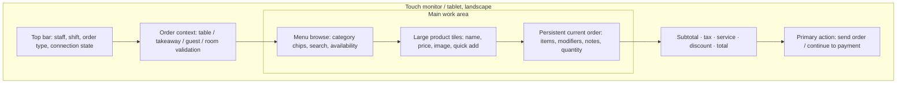

# POS UX design proposal

**Priority:** cashier usability during live service. This describes screen behavior, not a production mock-data path.

## Primary cashier screen

### Interaction rules

- Make the current order and total persistently visible on large touch screens. Use a two-pane browse/cart layout; allow the cart to become a clearly labeled drawer on narrow portrait screens.
- Prefer category chips, recents/favorites only if backed by real user/catalog data, product tiles, numeric quantity controls, and quick tender buttons. Do not force typing for normal ordering.
- Use minimum 48 CSS-pixel interactive targets where practical, generous gaps, visible focus, keyboard support, high-contrast text, and never rely on color alone for state.
- Keep menu search available but do not steal focus from order entry. Show unavailable products disabled with a reason.
- Require a table for dine-in. Require successful PMS validation before enabling folio posting. Guest lookup should return minimal data and show a clear no-match state.
- Modifiers show required/min/max rules and server-owned prices. Item notes and order-level kitchen notes have visible length limits.
- Totals are an estimate while editing; the server response is authoritative. Show a clear amount due/change state and prevent repeated submit while a request is in flight.
- After order submission, show an order identifier and kitchen state. After payment, show a confirmed receipt only after server/provider confirmation.
- Never clear cart/order data on a network failure unless the server confirms persistence; display a retry/recovery action tied to the same idempotency key.

## Screen inventory and design review order

1. **Cashier checkout (first):** order type → table/guest context → browse menu → configure line → review cart/totals → submit/send → payment → receipt.
2. **Tables:** floor/area and table occupancy, active order, reservations, safe transfer/merge actions only if supported.
3. **Orders/history:** open/in-service/completed/cancelled filters, line details, receipt access, status history, authorized adjustments.
4. **Kitchen display:** new/preparing/ready lanes, prep timers from server timestamps, item notes/modifiers, touch status transitions, unavailable/re-fire flows.
5. **Guests/reservations:** lookup and booking status; distinguish restaurant customer details from PMS stay/folio truth.
6. **Shift/register:** open float, cash movements, expected/count variance, close confirmation and audit.
7. **Manager/admin, inventory, reports, finance:** shared type, spacing, navigation, contrast, loading/empty/error patterns; dense tables stay practical rather than imitating cashier tiles.

## Required screen states

Each screen design includes initial loading, refresh, no data, filtered-no-results, validation, server rejection, timeout/unknown outcome, permission denied, expired sign-in, offline/degraded connection, and successful completion. Destructive or financial actions require a confirmation summary and, where policy says, a reason plus manager authorization.

## UI verification plan

- Review at common tablet/monitor widths and mobile portrait; check no clipped totals, hidden primary actions, or horizontal page scrolling.
- Test every primary flow with keyboard and touch-sized interactions, visible focus, screen-reader names, and 200% zoom.
- Use browser tests for product selection, modifier validation, order submission, payment result, and retry behavior once a frontend test runner is selected. Current `package.json` has no frontend test script.
- Use real API contracts in integration tests. Design previews may use isolated fixtures, but no fixture/fallback data may appear in production routes.
- Use screenshots for review only with synthetic/local data, never production guest/payment data.

## Open UI decisions

- Confirm whether bar/preparation stations need separate KDS queues.
- Confirm whether desktop offline is a supported cashier mode; if yes, define which actions are read-only or safely queueable.
- Confirm languages, currency formatting (repository currently displays KSh in POS UI), receipt printer behavior, accessibility requirements, and whether a customer display is required.
